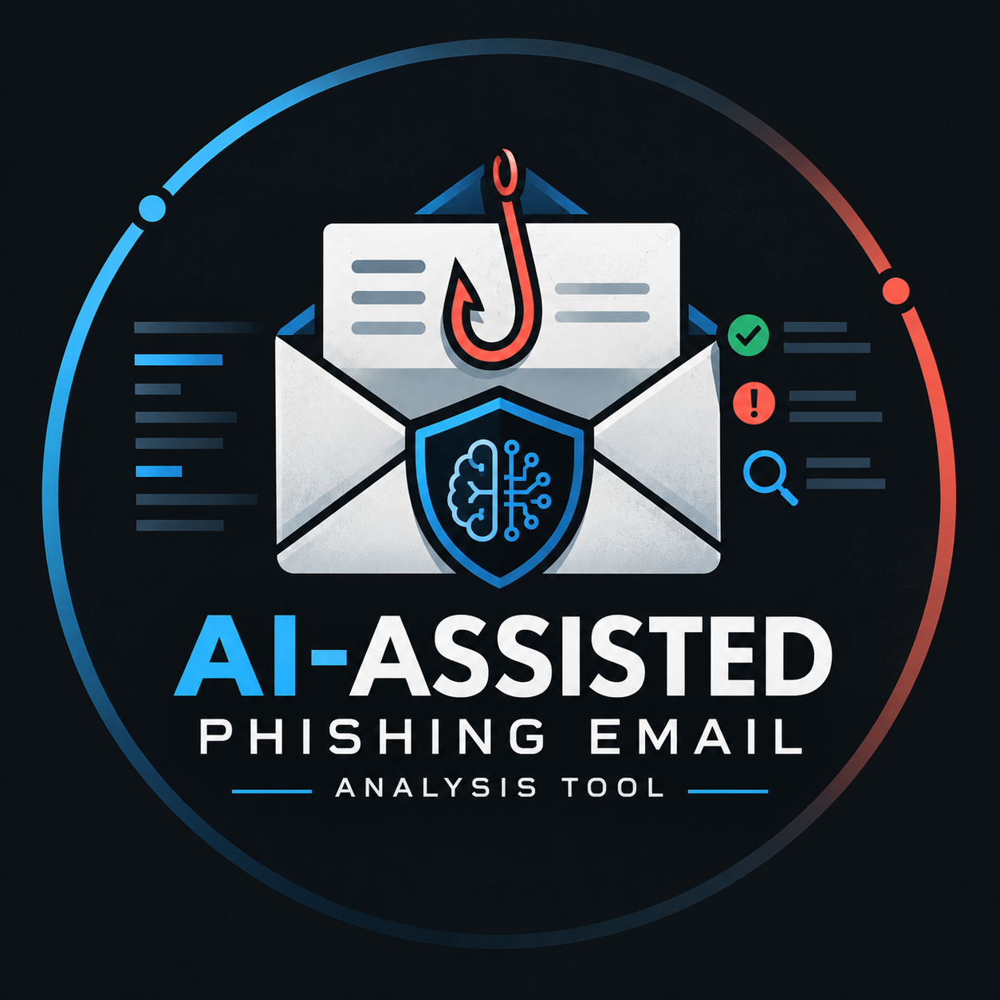

<p align="center">
  
</p>

<h1 align="center">
  AI-Assisted Phishing Email Analysis Tool
</h1>

<p align="center">
  Automated phishing investigation with threat intelligence
  and AI-assisted analysis.
</p>


# AI-Assisted Phishing Email Analysis Tool

A Python-based SOC investigation tool that helps security analysts examine suspicious emails, identify potential phishing indicators, collect threat intelligence, and generate structured investigation reports.

I built this project to bring several steps of a phishing investigation into one workflow. It combines traditional email analysis and threat intelligence with AI-assisted investigation, giving analysts both technical evidence and a clearer explanation of what that evidence means.

## What the Tool Does

- Parses email content and analyzes email headers.
- Checks SPF, DKIM, and DMARC authentication results.
- Extracts suspicious URLs, domains, IP addresses, and email addresses.
- Calculates file attachment hashes for further investigation.
- Queries VirusTotal and urlscan.io for threat intelligence.
- Correlates collected indicators and investigation evidence.
- Calculates a deterministic risk score and assigns a severity level.
- Uses AI to assess whether an email is potentially malicious or legitimate.
- Generates evidence-based explanations of suspicious email characteristics.
- Produces AI-assisted investigation summaries and incident response recommendations.
- Includes AI confidence information and identifies limitations in the available evidence.
- Generates an HTML investigation report.
- Supports incident creation in osTicket.

## AI Integration

One of the main additions to this project is the integration of AI into the phishing investigation process.

Traditional security tools can identify suspicious indicators, authentication failures, malicious URLs, and threat intelligence matches. However, analysts still need to examine those findings and understand how they relate to one another.

The AI component helps with that part of the investigation.

## Architecture
```
Phishing Email
      ↓
Email Parser
      ↓
Header & Authentication Analysis
      ↓
IOC & Attachment Extraction
      ↓
VirusTotal + urlscan.io
      ↓
Evidence Correlation
      ↓
Risk Scoring
      ↓
AI-Assisted Phishing Assessment
      ↓
SOC Investigation Report
      ↓
osTicket Incident

```
